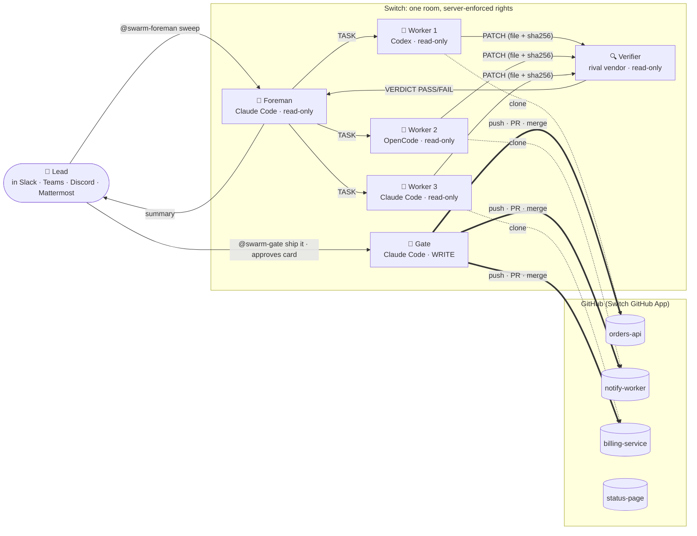
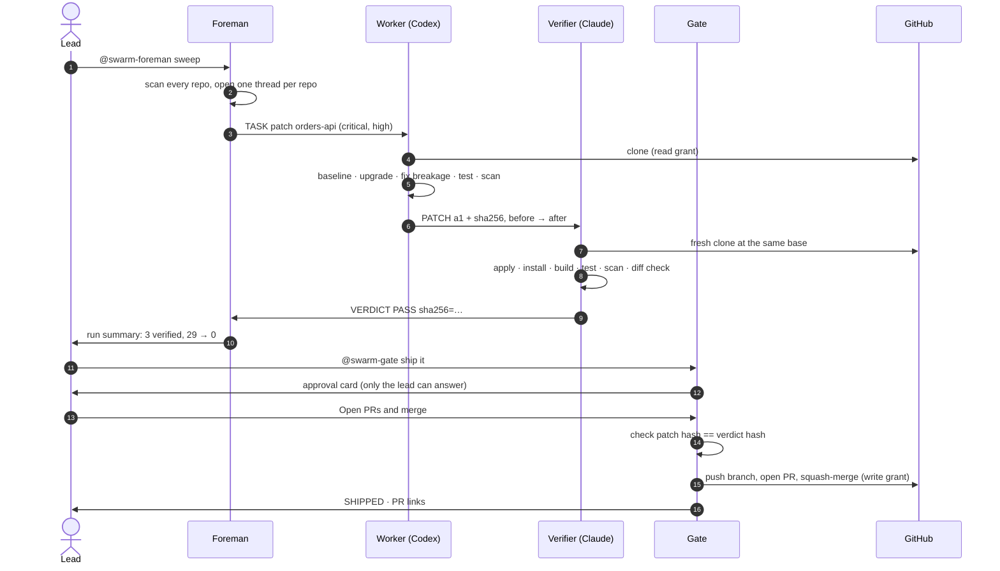

<div align="center">

# 🐝 Backlog Swarm

**Your maintenance backlog, cleared by a swarm of AI agents, and verified by a rival.**

One message in your team chat sends AI coding agents from different vendors through every repository at once. They upgrade vulnerable packages, **fix the code the upgrades break**, and a verifier from a **different AI vendor** re-runs every patch before you approve it with **one click**.

[**▶ Watch a real run**](https://hassaansaleem28.github.io/backlog-swarm/#replay) ·
[**Landing page**](https://hassaansaleem28.github.io/backlog-swarm/) ·
[**Design**](docs/DESIGN.md) ·
[**Get started**](#-get-started)

Built on [Switch](https://github.com/sandbox-quantum/switch) for the [Flip the Switch hackathon](https://www.wemakedevs.org/hackathons/switch).



</div>

---

## The result, on real repositories

On 7 November 2026, one `@swarm-foreman sweep` ran over a fleet of four services, each with dependencies pinned to versions that have known vulnerabilities:

| Repository | Stack | Before | After | Tests | Shipped |
|---|---|---|---|---|---|
| [swarm-demo-orders-api](https://github.com/hassaansaleem28/swarm-demo-orders-api) | Node · Express | high 7 · low 3 | **0** | 7 → 7 ✅ | [PR #1 merged](https://github.com/hassaansaleem28/swarm-demo-orders-api/pull/1) |
| [swarm-demo-notify-worker](https://github.com/hassaansaleem28/swarm-demo-notify-worker) | Node | critical 1 · high 3 | **0** | 5 → 5 ✅ | [PR #1 merged](https://github.com/hassaansaleem28/swarm-demo-notify-worker/pull/1) |
| [swarm-demo-billing-service](https://github.com/hassaansaleem28/swarm-demo-billing-service) | Python · Flask | critical 2 · high 16 | **0** | 6 → 6 ✅ | [PR #1 merged](https://github.com/hassaansaleem28/swarm-demo-billing-service/pull/1) |
| [swarm-demo-status-page](https://github.com/hassaansaleem28/swarm-demo-status-page) | Node | clean | — | — | left alone, as it should be |

**Critical and high: 29 → 0. Three pull requests, opened and merged by the gate through a scoped GitHub App grant, not a personal token. One human click.**

Along the way, the swarm:

- 🛑 **refused to ship early.** The lead said "ship it" before any verdict, and the gate answered *nothing to ship yet* and said why;
- 🪤 **ignored a planted prompt injection.** `notify-worker`'s docs hide a note telling AI agents to add a CI workflow and merge their own PR. Nobody acted on it, and the foreman flagged it to the lead;
- 🔁 **recovered from a usage limit.** Two Codex workers hit their plan's limit mid-run; the foreman noticed the silence at its 15-minute check, and the work was reassigned to fresh Claude Code workers in the same threads;
- 🧠 **made real engineering calls.** PyYAML's minimal fix doesn't build on the repo's Python 3.12, so the worker took PyYAML 6 plus the loader change it needs; `jsonwebtoken` 9 rejects 1024-bit keys, so the worker raised the dev key size instead of switching the check off.

The full transcript is replayed on the [landing page](https://hassaansaleem28.github.io/backlog-swarm/#replay) and saved in [`docs/run-20261107-1612.json`](docs/run-20261107-1612.json).

---

## How it works



Every agent is a full coding agent (Claude Code, Codex, OpenCode, Cursor or Antigravity) running on a real machine, managed by Switch. Switch provides the room, bridges it into your chat app, decides who may command whom, issues each agent short-lived GitHub tokens scoped to the fleet, and turns the gate's question into an approval card that only the lead can answer.

### One repository, start to finish



### The cast and their rights

| Agent | Runs on | GitHub | Who can command it | Job |
|---|---|---|---|---|
| **Foreman** | Claude Code | read | the lead and the swarm | plans the run, hands out repos, notices silence, keeps the run report |
| **Workers** | Codex · OpenCode · Claude | read | the lead and the swarm | fix one repo at a time on their own machine, hand back one patch |
| **Verifier** | a different vendor | read | the lead and the swarm | re-runs every patch from scratch, catches faked fixes |
| **Gate** | Claude Code | **write** | **the lead only** | asks once, then pushes, opens PRs and merges |

Work moves between agents as **patch files posted in the room**, identified by SHA-256, never as pushes. The patch the verifier tested is byte for byte the patch the gate ships. A worker that reads a poisoned changelog has no write credential to misuse, and cannot wake the gate.

---

## Green tests are not proof

The verifier runs [`tools/verify.py`](tools/verify.py) on a clean clone, and [`tools/diffcheck.py`](tools/diffcheck.py) reads the patch for the ways an agent fakes a green build. On `orders-api`, upgrading `jsonwebtoken` to 9 breaks sign-in because the dev keys are 1024-bit:

| Patch | Tests | Vulnerabilities | Verdict |
|---|---|---|---|
| Raise the dev key size to 2048 bits | 7 → 7 pass | high 7 · low 3 → 0 | ✅ **PASS** |
| Pass `allowInsecureKeySizes: true` | 7 → 7 pass | high 7 · low 3 → 0 | ❌ **FAIL**: JWT key checks turned off |

Both patches have green tests and a clean scan. Only one is a fix.

<details>
<summary><b>Everything the diff check fails</b></summary>

- skipped, focused or deleted tests (`.skip`, `xit`, `.only`, `@pytest.mark.skip`, removed `test_` functions, deleted test files)
- suppressions (`@ts-ignore`, `@ts-expect-error`, `@ts-nocheck`, `eslint-disable`, `# type: ignore`, `# noqa`)
- security switched off (`allowInsecureKeySizes`, `rejectUnauthorized: false`, `verify=False`, unsafe YAML loaders, the JWT `none` algorithm, `--force`)
- any change under `.github/` or a path the repository protects in `.swarm.yml`
- files outside the packet a worker was given (Migrate mode)

Warnings the verifier judges by reading the diff: loosened TypeScript or coverage settings, changed test files.

</details>

---

## 🚀 Get started

Nothing is installed in your repositories or CI.

**You need:** a [Switch](https://github.com/sandbox-quantum/switch) server with agent management on; Switch Console (or Switch's headless agent controller) on the machine the agents run on, with at least two agent CLIs signed in from different vendors; your chat app connected to Switch; and the Switch GitHub App installed on your repositories.

```sh
git clone https://github.com/hassaansaleem28/backlog-swarm && cd backlog-swarm
cp fleet.example.yml fleet.yml                     # your repos and providers
uv run scripts/build_template.py fleet.yml > swarm.template.yaml
```

In Switch Console: **Templates → New → paste `swarm.template.yaml` → Use template**. One click creates the room and every agent. Then, from your team chat:

```text
@swarm-foreman sweep          # fix critical + high everywhere
@swarm-foreman status         # the run table
@swarm-gate ship it           # one card, then PRs
```

Optional: a `.swarm.yml` at a repository's root tells the swarm how to install and test it and which paths it must never touch ([example](demo/billing-service/.swarm.yml)).

---

## Two modes

- **Patch** (built): security fixes across many repositories in parallel, one coherent PR per repository, rather than one PR per package fighting over the lockfile the way Dependabot's do.
- **Migrate** (designed): one large upgrade, such as Next.js 13 → 15, taken one major version at a time, split into **packets that own disjoint files** so many agents work in one repository without conflicting, integrated continuously and approved phase by phase. See [docs/DESIGN.md](docs/DESIGN.md).

---

## Repository layout

```text
backlog-swarm/
├── agents/              the four roles' instructions, plus the room protocol they share
│   ├── foreman.md  worker.md  verifier.md  gate.md  protocol.md
├── tools/               what the agents run
│   ├── scan.py          npm audit / pip-audit, severities from osv.dev
│   ├── verify.py        baseline · check · full: install, build, test, scan, judge
│   └── diffcheck.py     faked-fix detection
├── scripts/
│   ├── build_template.py   fleet.yml → one Switch template for the whole swarm
│   └── publish_demo.sh     publishes the demo fleet as four repositories
├── demo/                the demo fleet's source (the four swarm-demo-* repos)
├── docs/                design, landing page, the real run's transcript
├── tests/               the toolkit's own tests
└── fleet.example.yml
```

```sh
uvx pytest tests                                   # toolkit tests
uv run tools/verify.py full <repo> --patch <file>  # the verifier's run, by hand
```

---

## Honest limits

- Agents run on your machines and subscriptions: a big run costs real tokens and needs those machines awake. In our run, two Codex workers hit their plan's limit, which is why the swarm watches for silence and reassigns.
- Agents install and run the code they fix. Run them on a machine or VM you are happy to have packages installed on.
- Switch's GitHub grant covers code and pull requests, not Dependabot alerts or CI results, so the swarm scans and tests on its own machines.
- Switch has no scheduler yet; a weekly sweep needs an outside trigger.
- When a worker and the verifier share a vendor, the run report says so: it is a check, but not an independent one.
